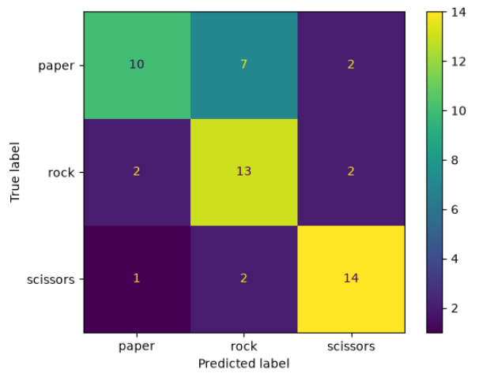
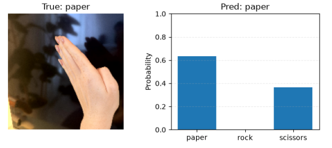
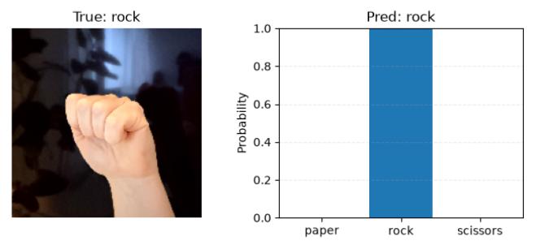
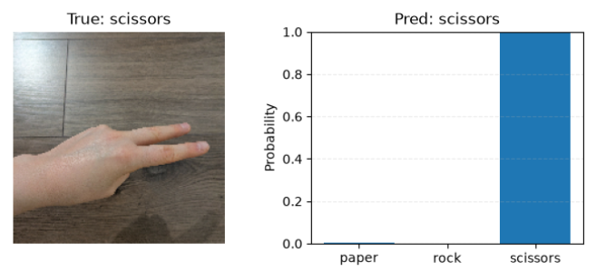

# Rock-Paper-Scissors Image Classification with VGG16

A transfer-learning project that adapts an ImageNet-pretrained VGG16 model to classify hand gestures as *paper*, *rock*, or *scissors*. The full workflow, experiments, and evaluation are in the [Jupyter notebook](./vgg16-rock-paper-scissors-fine-tuning.ipynb).

## Key Results

- Test accuracy: 69.8% (37 of 53 images; test loss: 1.7368).
- The best validation accuracy among the frozen-VGG16 experiments was 81.1%, achieved by adding L2 regularization and early stopping to the classifier head.
- After fine-tuning the last four VGG16 layers, the selected checkpoint achieved 69.8% test accuracy. It was selected using validation loss, not test performance.
- The model recognized 10/19 paper, 13/17 rock, and 14/17 scissors test images. Paper was most often mistaken for rock.

These results come from a small dataset and a single train/validation/test split. Treat the model as a learning prototype, not a production-ready classifier.

The confusion matrix below shows the model's predictions for each true class. The diagonal cells represent correct predictions; the off-diagonal cells show misclassifications.



### Example predictions

The examples below show one test image from each class alongside the model's predicted class and its probability for that prediction. They illustrate individual predictions; the test-set results above give a more complete picture of model performance.

| True class | Example prediction |
|---|---|
| Paper | <br>Prediction: paper – Probability: 62% |
| Rock | <br>Prediction: rock – Probability: 100% |
| Scissors | <br>Prediction: scissors – Probability: 100% |

## Project Overview

The notebook explores transfer learning on 297 self-taken hand-gesture images. It compares several classifier heads on top of a frozen VGG16 feature extractor, then fine-tunes the best-performing head by unfreezing the last four VGG16 layers. The notebook also plots training curves, evaluates the final checkpoint, displays sample predictions, and plots a confusion matrix.

### Validation experiments

| Experiment | Change to the classifier head | Best validation accuracy |
|---|---|---:|
| Model 1 | One 256-unit dense layer and 50% dropout | 73.6% |
| Model 2 | Added a 128-unit dense layer and adjusted dropout | 75.5% |
| Model 3 | Added L2 regularization and early stopping | 81.1% |
| Model 4 | Model 3 without early stopping | 75.5% |

The final fine-tuning stage started from Model 3 and unfroze the final four VGG16 layers. Its selected checkpoint had 73.6% validation accuracy at the epoch with the lowest validation loss. On the test set it reached an accuracy of 69.8%.

## Dataset

The notebook expects a local `rps` directory with separate training, validation, and test splits:

```text
rps/
├── train/
│   ├── paper/
│   ├── rock/
│   └── scissors/
├── validation/
│   ├── paper/
│   ├── rock/
│   └── scissors/
└── test/
    ├── paper/
    ├── rock/
    └── scissors/
```

The notebook's split contains 191 training images, 53 validation images, and 53 test images. The images are loaded at 180 × 180 pixels with a batch size of 32. The dataset itself is not included in this repository; provide your own images in the expected folder structure before running the notebook.

## Approach

1. Load the three image splits and apply random horizontal flips, rotations, and zooms during training.
2. Use ImageNet-pretrained VGG16 without its original classification head as a frozen feature extractor.
3. Compare four dense classifier heads, using dropout and, in Model 3, L2 regularization and early stopping.
4. Fine-tune the last four VGG16 layers with a low learning rate, saving the checkpoint with the best validation loss.
5. Evaluate the selected checkpoint on the test set and inspect its predictions and confusion matrix.

## Limitations

- There are only 297 images, including just 53 test images, so each test example has a noticeable effect on the reported accuracy.
- Paper was the weakest class on the test set (10 of 19 correctly classified).
- The best validation result did not translate directly to the fine-tuned model's test result. More data and evaluation on images from different people, backgrounds, and lighting conditions would be needed to assess generalization.
- The project demonstrates model training and evaluation; it does not include a deployed application.

## Tools

Python, Keras, TensorFlow, NumPy, Matplotlib, scikit-learn, and Jupyter Notebook.

## Running the Notebook

Install the required packages:

```bash
python -m pip install tensorflow keras numpy matplotlib scikit-learn jupyter
```

Place the dataset in the `rps/` directory shown above, then launch the notebook from the project directory:

```bash
jupyter notebook vgg16-rock-paper-scissors-fine-tuning.ipynb
```

Run the notebook from top to bottom. Keras downloads the VGG16 ImageNet weights when needed and saves training checkpoints locally.
